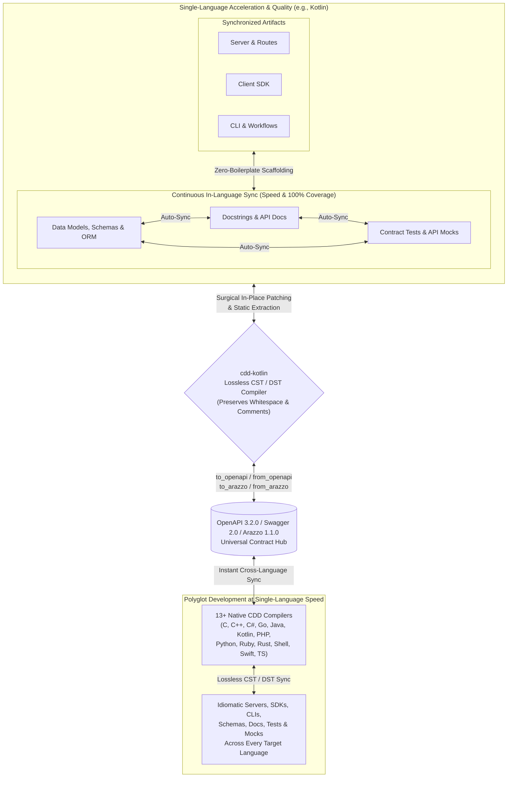

cdd-kotlin: Kotlin ⇄ OpenAPI
============================

[](https://opensource.org/licenses/Apache-2.0)
[](https://offscale.io/wasm_web_demo)
[](https://github.com/offscale/cdd-kotlin/actions)
[](#)
[](#)

**cdd-kotlin** compiles **[OpenAPI](https://spec.openapis.org/oas/latest.html) / [Swagger](https://spec.openapis.org/oas/v2.0.html) / [Arazzo](https://spec.openapis.org/arazzo/latest.html)** to and from **Kotlin** (servers, client SDKs, CLIs, database schemas, tests, mocks, and docs), updating your existing code in-place without overwriting your edits.

**Compiler Driven Development (CDD)** is a software engineering methodology that uses a suite of standalone, lossless compilers to synchronize API specifications, server implementations, client SDKs, command-line tooling, workflow orchestrators, tests, and documentation.

Unlike traditional code generators that treat outputs as disposable or read-only, Compiler Driven Development provides a **complete, standalone compiler** (exposed as both a CLI and a programmatic SDK) written natively in each supported language. Where conventional compilers rely solely on an Abstract Syntax Tree (AST) that discards formatting and comments, CDD compilers operate on a **Concrete Syntax Tree (CST)** or **Decorated Syntax Tree (DST)**. This guarantees **lossless conversion**—preserving exact whitespace, indentation, inline comments, block comments, and docstrings—allowing true bidirectional synchronization between hand-edited `Kotlin` source code and [OpenAPI 3.2.0](https://spec.openapis.org/oas/v3.2.0.html), [Swagger 2.0](https://spec.openapis.org/oas/v2.0.html), and [Arazzo 1.1.0](https://spec.openapis.org/arazzo/v1.1.0.html) specifications.

---

## Why Compiler Driven Development?

By replacing one-way templates and manual boilerplate with lossless CST/DST compilers, Compiler Driven Development transforms the engineering lifecycle across four dimensions:

- **Development Speed**: Eliminate manual boilerplate across servers, client SDKs, CLIs, database models, workflow runners, and mock servers. Start from an [OpenAPI](https://spec.openapis.org/oas/latest.html) or [Arazzo](https://spec.openapis.org/arazzo/latest.html) specification to scaffold an entire installable project (complete with package manifests and CI workflows), or write code first in `Kotlin` and extract the specification automatically. When requirements change, update whichever representation is most convenient and synchronize the rest immediately.
- **Development Consistency**: Every data model, route handler, CLI flag, ORM entity, workflow step, and API contract is derived from and validated against the same semantic representation. Architectural drift between backend routes, frontend clients, and published specifications becomes structurally impossible.
- **Development Quality**: Keeping tests and documentation in lockstep with implementation code is automated rather than an afterthought. Because the compiler parses and emits docstrings, type signatures, API mocks, and contract test suites alongside your business logic, maintaining **100% documentation coverage and 100% test coverage** becomes a natural byproduct of compilation rather than a manual chore.
- **Polyglot Development**: Seamlessly bridge **13+ programming languages** (C, C++, C#, Go, Java, Kotlin, PHP, Python, Ruby, Rust, POSIX Shell, Swift, and TypeScript) to and from [OpenAPI](https://spec.openapis.org/oas/latest.html) and [Arazzo](https://spec.openapis.org/arazzo/latest.html) specifications. Any codebase in any supported language can be reverse-compiled into OpenAPI/Arazzo and immediately compiled forward into idiomatic, human-editable code across every other language in the suite. And being an open-source methodology—rather than a proprietary trade secret—new languages can be added by implementing new compilers that follow the CDD approach (see [cdd-spec-conformance](https://github.com/SamuelMarks/cdd-spec-conformance) for tooling to facilitate).

---

## The Standalone Compiler Architecture and Lossless Conversion

Traditional code generation tools rely on destructive templating: if you regenerate your project from an updated specification, your custom implementation logic, formatting, and comments are overwritten.

Each Compiler Driven Development toolchain is written natively in its target language, compiles both to native binaries and to **WebAssembly (WASM/WASI)**, and implements a full lexer, parser, semantic differ, and code emitter backed by Concrete Syntax Tree (CST) and Decorated Syntax Tree (DST) representations:

- **Beyond AST to CST/DST**: A standard Abstract Syntax Tree (AST) captures program semantics while stripping away "trivia" (whitespace, blank lines, and comments). By pairing structural AST semantics with a Concrete Syntax Tree (CST) or Decorated Syntax Tree (DST) that attaches trivia and structured documentation directly to syntax nodes, the compiler preserves 100% of your source formatting and comments.
- **Zero-Destruction Guarantee**: Every part of the generated codebase is designed to be edited by humans. You can open generated routing files, data models, database entities, workflow runners, tests, and CLI commands, format them to your preferences, add inline comments, and inject custom business logic.
- **When your specification changes**: The CDD compiler parses your existing source files into a CST/DST, computes a semantic diff against the updated [OpenAPI](https://spec.openapis.org/oas/latest.html) or [Arazzo](https://spec.openapis.org/arazzo/latest.html) specification, and surgically patches in new endpoints, workflows, parameters, or fields without disturbing your custom logic, comments, or whitespace.
- **When your codebase changes**: The compiler statically analyzes your updated source code, routes, workflows, tests, and docstrings—without unsafe dynamic code execution or reflection—to extract a 100% compliant, authoritative [OpenAPI](https://spec.openapis.org/oas/latest.html) or [Arazzo](https://spec.openapis.org/arazzo/latest.html) specification.

---

## The Bidirectional Synchronization Loop



The Compiler Driven Development lifecycle delivers compounding returns in both single-language and polyglot environments:
1. **Single-Language Speed**: Edit whichever artifact is most convenient—models/schemas, route handlers, docstrings, or tests—and let `cdd-kotlin` surgically synchronize the rest in-place without overwriting your custom logic, comments, or whitespace.
2. **Single-Language Quality**: Because schemas, documentation, contract tests, and mocks are continuously cross-compiled rather than manually maintained, **100% doc coverage and 100% test coverage** are enforced automatically on every sync.
3. **Polyglot Development at Single-Language Speed**: Extracting an authoritative [OpenAPI](https://spec.openapis.org/oas/latest.html) or [Arazzo](https://spec.openapis.org/arazzo/latest.html) contract from one language immediately drives lossless forward-compilation across all 13+ supported languages—making multi-language SDK, CLI, and service maintenance just as fast as working in a single codebase.

---

## Core Capabilities Shared Across All CDD Compilers

Every `cdd-*` repository in the suite implements the same foundational feature set:

- **Bidirectional OpenAPI 3.2.0 & Swagger 2.0 Compilation**:
  - `from_openapi`: Generate idiomatic `Kotlin` Client SDKs (`to_sdk`), Client CLIs (`to_sdk_cli`), and Server stubs/routers (`to_server`) from a single specification (`-i`) or a batch directory of specifications (`--input-dir`). Automatically upgrades legacy Swagger 2.0 and OpenAPI 3.0/3.1 specifications to OpenAPI 3.2.0.
  - `to_openapi`: Statically parse existing `Kotlin` source files or directories to extract a compliant OpenAPI 3.2.0 specification.
- **Bidirectional Arazzo 1.1.0 Workflow Orchestration**:
  - `from_arazzo`: Compile multi-step [Arazzo 1.1.0](https://spec.openapis.org/arazzo/v1.1.0.html) workflow specifications (including runtime expressions, step DAGs, criterion evaluations, and failure/success actions) into `Kotlin` SDK workflow orchestrators (`to_sdk`), CLI workflow runners (`to_sdk_cli`), and Server/E2E workflow test suites (`to_server`).
  - `to_arazzo`: Reverse-parse `Kotlin` workflow orchestrators, CLI scripts, or E2E test suites back into an authoritative Arazzo 1.1.0 document.
- **In-Place Codebase Synchronization (`sync`)**:
  - Synchronize data models, ORM schemas, route handlers, docstrings, contract tests, mocks, and specifications in-place using lossless CST/DST patching.
- **Documentation Code-Snippet Generation (`to_docs_json`)**:
  - Emit a structured JSON documentation payload containing idiomatic `Kotlin` request/workflow code snippets for every operation in an OpenAPI specification (with `--no-imports` and `--no-wrapping` options for embedding in documentation portals).
- **Composable Contract Tests, Mocks, CI, and Package Scaffolding**:
  - By default, `from_openapi` and `from_arazzo` scaffold complete, installable `Kotlin` packages and `.github/workflows/ci.yml` pipelines (configurable via `--no-installable-package` and `--no-github-actions`), and generate contract test suites and API mocks/fakes via `--tests`.
- **Model Context Protocol (`mcp`) & JSON-RPC (`serve_json_rpc`)**:
  - Run `cdd-kotlin mcp` to expose the compiler over stdio as an [MCP](https://modelcontextprotocol.io/) server for AI assistants and IDEs, or pass `--mcp` during generation to emit MCP tool/resource adapters directly inside generated SDKs and servers.
  - Run `cdd-kotlin serve_json_rpc` to expose the compiler's full API over JSON-RPC 2.0 (`--port`, `--listen`).
- **Native CLI, Programmatic SDK, and WebAssembly (WASM/WASI)**:
  - Use `cdd-kotlin` from the command line, import its programmatic SDK directly into `Kotlin` applications, or run it in the browser and WASI runtimes via its WebAssembly build (see [WASM.md](WASM.md)).

---

## The Global Polyglot Ecosystem

Every supported language operates on the same core Compiler Driven Development principles and is powered by a dedicated, native compiler tailored to that language's syntax tree, idioms, and package manager.

All implementations expose a standardized command-line interface (`cdd-kotlin <subcommand>`) and programmatic SDK.

| Repository | Language | Targets (`to_sdk`; `to_sdk_cli`; `to_server`) | Special Features Beyond Common Subset | Standards | CI Status |
|---|---|---|---|---|---|
| [`cdd-c`](https://github.com/SamuelMarks/cdd-c) | C (C89) | Client; Client CLI; Server | 42-Language FFI Generator (`bind`); GNU-to-C89 AST Lowering; Safe CRT & Memory Security Auditor; `c-orm` Migrations | [Arazzo 1.1.0](https://spec.openapis.org/arazzo/v1.1.0.html); [Swagger 2.0](https://spec.openapis.org/oas/v2.0.html); [OpenAPI 3.2.0](https://spec.openapis.org/oas/v3.2.0.html); [MCP](https://modelcontextprotocol.io/) | [](https://github.com/SamuelMarks/cdd-c/actions/workflows/ci.yml) |
| [`cdd-cpp`](https://github.com/SamuelMarks/cdd-cpp) | C++ | Client; Client CLI; Server | [Google Discovery](https://developers.google.com/discovery) (`from_google_discovery`); PostgreSQL `libpq` ORM & Faker Support | [Google Discovery](https://developers.google.com/discovery); [Arazzo 1.1.0](https://spec.openapis.org/arazzo/v1.1.0.html); [Swagger 2.0](https://spec.openapis.org/oas/v2.0.html); [OpenAPI 3.2.0](https://spec.openapis.org/oas/v3.2.0.html); [MCP](https://modelcontextprotocol.io/) | [](https://github.com/SamuelMarks/cdd-cpp/actions/workflows/ci.yml) |
| [`cdd-csharp`](https://github.com/SamuelMarks/cdd-csharp) | C# | Client; Client CLI; Server | CLR & Roslyn CST/DST Trivia-Preserving Sync; Entity Framework & Minimal API Targets | [Arazzo 1.1.0](https://spec.openapis.org/arazzo/v1.1.0.html); [Swagger 2.0](https://spec.openapis.org/oas/v2.0.html); [OpenAPI 3.2.0](https://spec.openapis.org/oas/v3.2.0.html); [MCP](https://modelcontextprotocol.io/) | [](https://github.com/SamuelMarks/cdd-csharp/actions/workflows/ci.yml) |
| [`cdd-go`](https://github.com/SamuelMarks/cdd-go) | Go | Client; Client CLI; Server | Go `dst`/`ast` Surgical Patching; Multi-Source Truth Sync (`code` ⇄ `openapi`) | [Arazzo 1.1.0](https://spec.openapis.org/arazzo/v1.1.0.html); [Swagger 2.0](https://spec.openapis.org/oas/v2.0.html); [OpenAPI 3.2.0](https://spec.openapis.org/oas/v3.2.0.html); [MCP](https://modelcontextprotocol.io/) | [](https://github.com/SamuelMarks/cdd-go/actions/workflows/ci.yml) |
| [`cdd-java`](https://github.com/SamuelMarks/cdd-java) | Java | Client; Client CLI; Server | JavaParser CST Lexical Preservation; WASI JSON-RPC Mode; In-Memory Compiler Pipeline | [Arazzo 1.1.0](https://spec.openapis.org/arazzo/v1.1.0.html); [Swagger 2.0](https://spec.openapis.org/oas/v2.0.html); [OpenAPI 3.2.0](https://spec.openapis.org/oas/v3.2.0.html); [MCP](https://modelcontextprotocol.io/) | [](https://github.com/SamuelMarks/cdd-java/actions/workflows/ci.yml) |
| [`cdd-kotlin`](https://github.com/offscale/cdd-kotlin) | Kotlin (Ktor Multiplatform) | Client; Client CLI; Server | Multiplatform Auto-Admin UI; Ephemeral & Seeded Mock Server Modes; Webhook Triggers | [Arazzo 1.1.0](https://spec.openapis.org/arazzo/v1.1.0.html); [Swagger 2.0](https://spec.openapis.org/oas/v2.0.html); [OpenAPI 3.2.0](https://spec.openapis.org/oas/v3.2.0.html); [MCP](https://modelcontextprotocol.io/) | [](https://github.com/offscale/cdd-kotlin/actions/workflows/ci.yml) |
| [`cdd-php`](https://github.com/SamuelMarks/cdd-php) | PHP | Client; Client CLI; Server | Multi-Tiered DAO (`StubDao` / `ConcreteDao`); Ephemeral & Faker-Seeded SQLite Server Modes | [Arazzo 1.1.0](https://spec.openapis.org/arazzo/v1.1.0.html); [Swagger 2.0](https://spec.openapis.org/oas/v2.0.html); [OpenAPI 3.2.0](https://spec.openapis.org/oas/v3.2.0.html); [MCP](https://modelcontextprotocol.io/) | [](https://github.com/SamuelMarks/cdd-php/actions/workflows/ci.yml) |
| [`cdd-python`](https://github.com/offscale/cdd-python) | Python | N/A (server building blocks) | CLI ⇄ SQLAlchemy ⇄ Pydantic ⇄ Docs ⇄ JSON Schema | N/A | [](https://github.com/offscale/cdd-python/actions) |
| [`cdd-python-all`](https://github.com/offscale/cdd-python-all) | Python | Client; Client CLI; Server | `LibCST` Lossless Sync; Multi-Truth Sync (`class`, `sqlalchemy`, `function`, `openapi`); FastAPI + SQLAlchemy | [Arazzo 1.1.0](https://spec.openapis.org/arazzo/v1.1.0.html); [Swagger 2.0](https://spec.openapis.org/oas/v2.0.html); [OpenAPI 3.2.0](https://spec.openapis.org/oas/v3.2.0.html); [MCP](https://modelcontextprotocol.io/) | [](https://github.com/offscale/cdd-python-all/actions/workflows/ci.yml) |
| [`cdd-ruby`](https://github.com/SamuelMarks/cdd-ruby) | Ruby | Client; Client CLI; Server | ActiveRecord Sync (`class`, `activerecord`, `function`); Ephemeral & Seeded Server Generation | [Arazzo 1.1.0](https://spec.openapis.org/arazzo/v1.1.0.html); [Swagger 2.0](https://spec.openapis.org/oas/v2.0.html); [OpenAPI 3.2.0](https://spec.openapis.org/oas/v3.2.0.html); [MCP](https://modelcontextprotocol.io/) | [](https://github.com/SamuelMarks/cdd-ruby/actions/workflows/ci.yml) |
| [`cdd-rust`](https://github.com/SamuelMarks/cdd-rust) | Rust | Client; Client CLI; Server | Actix-Web, Axum & Reqwest Targets; Diesel Schema Sync; Standalone `schema-gen`, `scaffold` & `test-gen` | [Arazzo 1.1.0](https://spec.openapis.org/arazzo/v1.1.0.html); [Swagger 2.0](https://spec.openapis.org/oas/v2.0.html); [OpenAPI 3.2.0](https://spec.openapis.org/oas/v3.2.0.html); [MCP](https://modelcontextprotocol.io/) | [](https://github.com/SamuelMarks/cdd-rust/actions/workflows/ci.yml) |
| [`cdd-sh`](https://github.com/SamuelMarks/cdd-sh) | Shell (`/bin/sh`) | Client; Client CLI; Server | Zero-Dependency Embedded `sh`/`jq`/`awk` Cross-Platform Binary; Direct AST `parse` & `emit` Subcommands | [Arazzo 1.1.0](https://spec.openapis.org/arazzo/v1.1.0.html); [Swagger 2.0](https://spec.openapis.org/oas/v2.0.html); [OpenAPI 3.2.0](https://spec.openapis.org/oas/v3.2.0.html); [MCP](https://modelcontextprotocol.io/) | [](https://github.com/SamuelMarks/cdd-sh/actions/workflows/ci.yml) |
| [`cdd-swift`](https://github.com/SamuelMarks/cdd-swift) | Swift | Client; Client CLI; Server | `SwiftSyntax` Lossless Merging (`merge_swift`); Vapor + Fluent ORM Scaffolding; `sync_arazzo` | [Arazzo 1.1.0](https://spec.openapis.org/arazzo/v1.1.0.html); [Swagger 2.0](https://spec.openapis.org/oas/v2.0.html); [OpenAPI 3.2.0](https://spec.openapis.org/oas/v3.2.0.html); [MCP](https://modelcontextprotocol.io/) | [](https://github.com/SamuelMarks/cdd-swift/actions/workflows/ci.yml) |
| [`cdd-ts`](https://github.com/offscale/cdd-ts) | TypeScript | Client; Client CLI; Server | Auto-Admin UI; Angular, React, Vue, Vanilla; Fetch, Axios, Node; Express, Bun, Deno; TypeORM Sync | [Arazzo 1.1.0](https://spec.openapis.org/arazzo/v1.1.0.html); [Swagger 2.0](https://spec.openapis.org/oas/v2.0.html); [OpenAPI 3.2.0](https://spec.openapis.org/oas/v3.2.0.html); [MCP](https://modelcontextprotocol.io/) | [](https://github.com/offscale/cdd-ts/actions/workflows/ci.yml) |

---

## Programmatic SDK & CLI Quickstart

Every `cdd-*` toolchain can be invoked either as a standalone CLI binary or imported as a native `Kotlin` library.

### Minimal CLI Usage

```sh
# Print help and version
cdd-kotlin --help
cdd-kotlin --version

# Generate a Kotlin Client SDK, Client CLI, or Server from an OpenAPI spec
cdd-kotlin from_openapi to_sdk -i spec.json -o ./sdk --tests
cdd-kotlin from_openapi to_sdk_cli -i spec.json -o ./cli --tests
cdd-kotlin from_openapi to_server -i spec.json -o ./server --tests

# Extract an OpenAPI 3.2.0 spec from existing Kotlin source code
cdd-kotlin to_openapi -i ./src -o openapi.json

# Generate and extract Arazzo 1.1.0 multi-step workflows
cdd-kotlin from_arazzo to_sdk -i workflow.arazzo.json -o ./workflows --tests
cdd-kotlin from_arazzo to_sdk_cli -i workflow.arazzo.json -o ./workflow-cli --tests
cdd-kotlin from_arazzo to_server -i workflow.arazzo.json -o ./workflow-server --tests
cdd-kotlin to_arazzo -i ./workflows -o extracted.arazzo.json

# Synchronize codebase models, routes, tests, docs, and OpenAPI in-place
cdd-kotlin sync -i ./src -o openapi.json

# Generate documentation-ready Kotlin code snippets JSON for an OpenAPI spec
cdd-kotlin to_docs_json --no-imports --no-wrapping -i spec.json -o docs.json

# Run as a Model Context Protocol (MCP) server over stdio or JSON-RPC 2.0 server
cdd-kotlin mcp
cdd-kotlin serve_json_rpc --port 8080 --listen 127.0.0.1
```

### Programmatic SDK Example

```kotlin
import generateToArazzo
import generateToOpenApi
import org.cdd.CddGenerator
import org.cdd.Config
import performSync

fun main() {
    val config = Config(
        inputPath = "spec.json",
        outputDir = "./generated-sdk",
        noGithubActions = false,
        noInstallablePackage = false,
        tests = true
    )

    // 1. Compile OpenAPI 3.2.0 / Swagger 2.0 -> Kotlin Multiplatform SDK & Server
    CddGenerator.generateSdk(config, includeCli = true).getOrThrow()
    CddGenerator.generateServer(config.copy(outputDir = "./generated-server")).getOrThrow()

    // 2. Reverse-compile Kotlin PSI source directory -> OpenAPI 3.2.0 & Arazzo 1.1.0
    generateToOpenApi(inputDir = "./generated-sdk", outputFile = "openapi.json").getOrThrow()
    generateToArazzo(inputDir = "./generated-sdk", outputFile = "workflows.arazzo.json").getOrThrow()

    // 3. Synchronize Kotlin DTOs, Exposed DAOs, and OpenAPI specs in-place
    performSync(inputDir = "./generated-server", truth = "class").getOrThrow()
}
```

### Installation & Development

All `cdd-*` repositories support both native language build tools and a standardized cross-platform `Makefile` / `make.bat` interface (`deps`, `build`, `test`):

```sh
make deps
make build
make test
# or on Windows:
.\make.bat deps
.\make.bat build
.\make.bat test
```

```sh
# Build JVM and WASI (wasmWasi) targets via Gradle
./gradlew assemble

# Format source code with Spotless (ktfmt)
./gradlew spotlessApply

# Run unit tests, KDoc coverage (100%), and Kover test coverage (100% LINE, INSTRUCTION, BRANCH)
./gradlew check

# Build the standalone WASI binary into bin/cdd-kotlin.wasm
make build_wasm

# Run the CLI directly via Gradle or wrapper script
./gradlew run --args="--help"
./cdd.sh --help
```

> **Further Documentation**:
> - [**ARCHITECTURE.md**](ARCHITECTURE.md) — Compiler pipeline (Lexer → CST/DST/AST → Semantic Diff → Emitter).
> - [**COMPLIANCE.md**](COMPLIANCE.md) — Swagger 2.0, OpenAPI 3.2.0, Arazzo 1.1.0, and MCP support matrices.
> - [**USAGE.md**](USAGE.md) — Detailed CLI, SDK, ORM, and roundtrip usage guide.
> - [**DEVELOPING.md**](DEVELOPING.md) — Local development, linting, testing, and coverage guide.
> - [**WASM.md**](WASM.md) — WebAssembly / WASI build and browser/Node.js execution instructions.
> - [**PUBLISH.md**](PUBLISH.md) — Package publishing and release workflow.

---

## Universal CLI Toolchain

Once you learn the Compiler Driven Development CLI in one language, you can use the exact same commands, flags, and environment variables across the entire polyglot stack.

### Common Arguments & Environment Variables

| Flag | Short | Environment Variable | Description |
|---|---|---|---|
| `--help` | `-h` | — | Print help information for the CLI or subcommand. |
| `--version` | `-v` / `-V` | — | Print version information. |
| `--input <path>` | `-i` / `-f` | `CDD_INPUT` | Path or URL to the input OpenAPI/Arazzo spec or source file/directory. |
| `--input-dir <dir>` | `-d` | `CDD_INPUT_DIR` | Directory containing multiple OpenAPI/Arazzo specifications for batch generation. |
| `--output <path>` | `-o` | `CDD_OUTPUT` | Destination file or directory path for generated code or extracted specifications. |
| `--tests` | `-t` | `CDD_TESTS` | Generate composable contract/integration tests and API mocks alongside code. |
| `--mcp` | `-m` | `CDD_MCP` | Generate Model Context Protocol (MCP) server and client adapters. |
| `--no-github-actions` | — | `CDD_NO_GITHUB_ACTIONS` | Do not generate `.github/workflows/ci.yml` scaffolding in target output. |
| `--no-installable-package` | — | `CDD_NO_INSTALLABLE_PACKAGE` | Do not generate package manifest/build files in target output. |
| `--no-imports` | — | `CDD_NO_IMPORTS` | (`to_docs_json`) Omit import/include statements from generated documentation snippets. |
| `--no-wrapping` | — | `CDD_NO_WRAPPING` | (`to_docs_json`) Omit boilerplate wrapper functions/classes from documentation snippets. |
| `--port <port>` | `-p` | `CDD_PORT` | (`serve_json_rpc`) TCP port to listen on (default: `8080`). |
| `--listen <addr>` | `-l` | `CDD_LISTEN` | (`serve_json_rpc`) Host/IP address to bind to (default: `127.0.0.1`). |
| `--truth <source>` | `-t` | `CDD_TRUTH` | (`sync`) Designate the single source of truth when synchronizing. |

### Core Subcommands

- **`from_openapi [to_sdk | to_sdk_cli | to_server]`**: Compile an OpenAPI 3.2.0 or Swagger 2.0 specification into an idiomatic `Kotlin` Client SDK, Client CLI, or HTTP Server (patching existing files losslessly if the target directory already exists).
- **`to_openapi`**: Statically parse `Kotlin` models, routes, client calls, and docstrings into an authoritative OpenAPI 3.2.0 specification.
- **`from_arazzo [to_sdk | to_sdk_cli | to_server]`**: Compile an Arazzo 1.1.0 workflow specification into `Kotlin` workflow orchestrators, CLI workflow runners, or server/E2E workflow test suites.
- **`to_arazzo`**: Statically parse `Kotlin` workflow code, CLI scripts, or E2E tests into an Arazzo 1.1.0 specification.
- **`sync`**: Bidirectionally synchronize `Kotlin` source files (models, ORM entities, routes, functions, tests, and docstrings) with OpenAPI/Arazzo specifications in-place.
- **`to_docs_json`**: Generate documentation-optimized JSON containing `Kotlin` code snippets for each operation in an OpenAPI specification.
- **`serve_json_rpc`**: Expose the `cdd-kotlin` compiler over a JSON-RPC 2.0 server for IDE integrations and external tooling.
- **`mcp`**: Run the `cdd-kotlin` compiler as a Model Context Protocol (MCP) server over standard I/O (`stdio`).

### Verbatim CLI Help Output

#### `cdd-kotlin --help`

```text
cdd-kotlin CLI
Usage:
  cdd-kotlin [subcommand] [options]

Subcommands:
  from_openapi    Generate code from an OpenAPI specification.
  to_openapi      Generate an OpenAPI specification from source code.
  from_arazzo     Generate SDK, CLI, or Server code from an Arazzo 1.1.0 specification.
  to_arazzo       Generate an Arazzo 1.1.0 specification from Kotlin workflow source code.
  sync            Synchronize Kotlin DTOs, Exposed DAOs, Arazzo workflows, and OpenAPI specs.
  to_docs_json    Generate JSON documentation with code snippets for an OpenAPI specification.
  serve_json_rpc  Run the JSON RPC server via stdio.
  mcp             Run the Model Context Protocol server via stdio.
  demo            Generate a sample Kotlin Multiplatform scaffold project.

Options:
  --help, -h      Show this help message
  --version, -v   Show version information

Examples:
  cdd-kotlin to_docs_json --no-imports --no-wrapping -i spec.json -o docs.json
  cdd-kotlin from_openapi to_sdk_cli -i spec.json -o target_directory [--no-github-actions] [--no-installable-package] [--tests]
  cdd-kotlin from_openapi to_sdk -i spec.json -o target_directory [--no-github-actions] [--no-installable-package] [--tests]
  cdd-kotlin from_arazzo to_sdk -i arazzo.json -o target_directory [--no-github-actions] [--no-installable-package] [--tests]
  cdd-kotlin to_arazzo -i src_directory -o arazzo.json
```

#### `cdd-kotlin from_openapi --help`

```text
Usage: cdd-kotlin from_openapi [to_sdk|to_sdk_cli|to_server] [options]

Generate Kotlin Multiplatform SDK, CLI, or Ktor Server code from an OpenAPI (2.0 / 3.0 / 3.1 / 3.2) specification.

Subcommands:
  to_sdk          Generate a Kotlin Multiplatform Client SDK (default)
  to_sdk_cli      Generate a Kotlin Multiplatform Client SDK and Clikt CLI
  to_server       Generate a Ktor Server with Exposed ORM DAOs, Faker seeder, IdP, and webhooks

Options:
  -i, --input <file>          Input specification file (.json or .yaml)
  --input-dir <dir>           Input directory containing specification files
  -o, --output <dir>          Output directory for generated project (default: out)
  --no-github-actions         Skip generating .github/workflows/ci.yml
  --no-installable-package    Skip generating Gradle build scaffolding
  --tests                     Generate companion unit, mock, and E2E test suites
  -h, --help                  Show this help message

Environment Variables:
  CDD_INPUT                   Default input specification file
  CDD_INPUT_DIR               Default input specification directory
  CDD_OUTPUT                  Default output directory
  CDD_NO_GITHUB_ACTIONS       Set to true/1 to skip GitHub Actions generation
  CDD_NO_INSTALLABLE_PACKAGE  Set to true/1 to skip Gradle package scaffolding
  CDD_TESTS                   Set to true/1 to generate test suites
```

#### `cdd-kotlin from_openapi to_sdk --help`

```text
Usage: cdd-kotlin from_openapi to_sdk -i <spec.json|yaml> [-o <output_dir>] [options]

Generate Kotlin Multiplatform Client SDK from an OpenAPI specification.

Options:
  -i, --input <file>          Input specification file (.json or .yaml)
  --input-dir <dir>           Input directory containing specification files
  -o, --output <dir>          Output directory for generated project (default: out)
  --no-github-actions         Skip generating .github/workflows/ci.yml
  --no-installable-package    Skip generating Gradle build scaffolding
  --tests                     Generate companion unit, mock, and E2E test suites
  -h, --help                  Show this help message

Environment Variables:
  CDD_INPUT                   Default input specification file
  CDD_INPUT_DIR               Default input specification directory
  CDD_OUTPUT                  Default output directory
  CDD_NO_GITHUB_ACTIONS       Set to true/1 to skip GitHub Actions generation
  CDD_NO_INSTALLABLE_PACKAGE  Set to true/1 to skip Gradle package scaffolding
  CDD_TESTS                   Set to true/1 to generate test suites
```

#### `cdd-kotlin from_openapi to_sdk_cli --help`

```text
Usage: cdd-kotlin from_openapi to_sdk_cli -i <spec.json|yaml> [-o <output_dir>] [options]

Generate Kotlin Multiplatform Client SDK + Clikt CLI from an OpenAPI specification.

Options:
  -i, --input <file>          Input specification file (.json or .yaml)
  --input-dir <dir>           Input directory containing specification files
  -o, --output <dir>          Output directory for generated project (default: out)
  --no-github-actions         Skip generating .github/workflows/ci.yml
  --no-installable-package    Skip generating Gradle build scaffolding
  --tests                     Generate companion unit, mock, and E2E test suites
  -h, --help                  Show this help message

Environment Variables:
  CDD_INPUT                   Default input specification file
  CDD_INPUT_DIR               Default input specification directory
  CDD_OUTPUT                  Default output directory
  CDD_NO_GITHUB_ACTIONS       Set to true/1 to skip GitHub Actions generation
  CDD_NO_INSTALLABLE_PACKAGE  Set to true/1 to skip Gradle package scaffolding
  CDD_TESTS                   Set to true/1 to generate test suites
```

#### `cdd-kotlin from_openapi to_server --help`

```text
Usage: cdd-kotlin from_openapi to_server -i <spec.json|yaml> [-o <output_dir>] [options]

Generate Ktor Server, Exposed DAOs, Faker Seeder, IdP, and Webhooks from an OpenAPI specification.

Options:
  -i, --input <file>          Input specification file (.json or .yaml)
  --input-dir <dir>           Input directory containing specification files
  -o, --output <dir>          Output directory for generated project (default: out)
  --no-github-actions         Skip generating .github/workflows/ci.yml
  --no-installable-package    Skip generating Gradle build scaffolding
  --tests                     Generate companion unit, mock, and E2E test suites
  -h, --help                  Show this help message

Environment Variables:
  CDD_INPUT                   Default input specification file
  CDD_INPUT_DIR               Default input specification directory
  CDD_OUTPUT                  Default output directory
  CDD_NO_GITHUB_ACTIONS       Set to true/1 to skip GitHub Actions generation
  CDD_NO_INSTALLABLE_PACKAGE  Set to true/1 to skip Gradle package scaffolding
  CDD_TESTS                   Set to true/1 to generate test suites
```

#### `cdd-kotlin to_openapi --help`

```text
Usage: cdd-kotlin to_openapi -i <source_dir> [-o <spec.json>]

Extract an OpenAPI 3.2.0 specification from Kotlin PSI source files.

Options:
  -i, --input <dir>       Input directory containing Kotlin source files (.kt)
  -o, --output <file>     Output OpenAPI JSON file path (default: out.json)
  -h, --help              Show this help message

Environment Variables:
  CDD_INPUT               Default input source directory
  CDD_OUTPUT              Default output specification path
```

#### `cdd-kotlin from_arazzo --help`

```text
Usage: cdd-kotlin from_arazzo [to_sdk|to_sdk_cli|to_server] [options]

Generate Kotlin workflow orchestrators, CLI runners, or Ktor server routes from an Arazzo 1.1.0 specification.

Subcommands:
  to_sdk          Generate a Kotlin Multiplatform Workflow SDK (default)
  to_sdk_cli      Generate a Kotlin Multiplatform Workflow SDK and CLI runner
  to_server       Generate Ktor workflow routes, stateful mock server, and E2E tests

Options:
  -i, --input <file>          Input specification file (.json or .yaml)
  -o, --output <dir>          Output directory for generated project (default: out)
  --no-github-actions         Skip generating .github/workflows/ci.yml
  --no-installable-package    Skip generating Gradle build scaffolding
  --tests                     Generate companion unit, mock, and E2E test suites
  -h, --help                  Show this help message

Environment Variables:
  CDD_INPUT                   Default input specification file
  CDD_OUTPUT                  Default output directory
  CDD_NO_GITHUB_ACTIONS       Set to true/1 to skip GitHub Actions generation
  CDD_NO_INSTALLABLE_PACKAGE  Set to true/1 to skip Gradle package scaffolding
  CDD_TESTS                   Set to true/1 to generate test suites
```

#### `cdd-kotlin from_arazzo to_sdk --help`

```text
Usage: cdd-kotlin from_arazzo to_sdk -i <arazzo.json|yaml> [-o <output_dir>] [options]

Generate Kotlin Multiplatform Arazzo Workflow SDK from an Arazzo 1.1.0 specification.

Options:
  -i, --input <file>          Input specification file (.json or .yaml)
  -o, --output <dir>          Output directory for generated project (default: out)
  --no-github-actions         Skip generating .github/workflows/ci.yml
  --no-installable-package    Skip generating Gradle build scaffolding
  --tests                     Generate companion unit, mock, and E2E test suites
  -h, --help                  Show this help message

Environment Variables:
  CDD_INPUT                   Default input specification file
  CDD_OUTPUT                  Default output directory
  CDD_NO_GITHUB_ACTIONS       Set to true/1 to skip GitHub Actions generation
  CDD_NO_INSTALLABLE_PACKAGE  Set to true/1 to skip Gradle package scaffolding
  CDD_TESTS                   Set to true/1 to generate test suites
```

#### `cdd-kotlin from_arazzo to_sdk_cli --help`

```text
Usage: cdd-kotlin from_arazzo to_sdk_cli -i <arazzo.json|yaml> [-o <output_dir>] [options]

Generate Kotlin Multiplatform Arazzo Workflow SDK + CLI from an Arazzo 1.1.0 specification.

Options:
  -i, --input <file>          Input specification file (.json or .yaml)
  -o, --output <dir>          Output directory for generated project (default: out)
  --no-github-actions         Skip generating .github/workflows/ci.yml
  --no-installable-package    Skip generating Gradle build scaffolding
  --tests                     Generate companion unit, mock, and E2E test suites
  -h, --help                  Show this help message

Environment Variables:
  CDD_INPUT                   Default input specification file
  CDD_OUTPUT                  Default output directory
  CDD_NO_GITHUB_ACTIONS       Set to true/1 to skip GitHub Actions generation
  CDD_NO_INSTALLABLE_PACKAGE  Set to true/1 to skip Gradle package scaffolding
  CDD_TESTS                   Set to true/1 to generate test suites
```

#### `cdd-kotlin from_arazzo to_server --help`

```text
Usage: cdd-kotlin from_arazzo to_server -i <arazzo.json|yaml> [-o <output_dir>] [options]

Generate Ktor Arazzo Workflow Server Routes, Mock Server, and E2E Tests from an Arazzo 1.1.0 specification.

Options:
  -i, --input <file>          Input specification file (.json or .yaml)
  -o, --output <dir>          Output directory for generated project (default: out)
  --no-github-actions         Skip generating .github/workflows/ci.yml
  --no-installable-package    Skip generating Gradle build scaffolding
  --tests                     Generate companion unit, mock, and E2E test suites
  -h, --help                  Show this help message

Environment Variables:
  CDD_INPUT                   Default input specification file
  CDD_OUTPUT                  Default output directory
  CDD_NO_GITHUB_ACTIONS       Set to true/1 to skip GitHub Actions generation
  CDD_NO_INSTALLABLE_PACKAGE  Set to true/1 to skip Gradle package scaffolding
  CDD_TESTS                   Set to true/1 to generate test suites
```

#### `cdd-kotlin to_arazzo --help`

```text
Usage: cdd-kotlin to_arazzo -i <source_dir_or_file> [-o <arazzo.json|yaml>]

Extract an Arazzo 1.1.0 workflow specification from Kotlin workflow source code.

Options:
  -i, --input <path>      Input Kotlin workflow source directory or .kt file
  -o, --output <file>     Output Arazzo 1.1.0 specification path (.json or .yaml, default: arazzo.json)
  -h, --help              Show this help message

Environment Variables:
  CDD_INPUT               Default input workflow source path
  CDD_OUTPUT              Default output Arazzo specification path
```

#### `cdd-kotlin sync --help`

```text
Usage: cdd-kotlin sync -i <project_dir> [--truth <class|dao|arazzo|openapi>]

Bi-directionally synchronize Kotlin data classes, Exposed DAOs, Arazzo workflows, and OpenAPI specifications.

Options:
  -i, --input-dir <dir>   Target project directory to synchronize
  --truth <source>        Authoritative source of truth: class, dao, arazzo, or openapi (default: class)
  -h, --help              Show this help message

Environment Variables:
  CDD_INPUT_DIR           Default project directory to synchronize
```

#### `cdd-kotlin to_docs_json --help`

```text
Usage: cdd-kotlin to_docs_json -i <spec.json|yaml> [-o <docs.json>] [options]

Generate JSON documentation with Ktor client code snippets for an OpenAPI specification.

Options:
  -i, --input <file>      Input OpenAPI specification file (.json or .yaml)
  -o, --output <file>     Optional output file for generated documentation JSON
  --no-imports            Omit import statements from generated Ktor snippets
  --no-wrapping           Omit suspend fun main() wrapper from generated snippets
  -h, --help              Show this help message

Environment Variables:
  CDD_INPUT, INPUT        Default input OpenAPI specification path
  CDD_OUTPUT              Default output documentation JSON path
  CDD_NO_IMPORTS          Set to true/1 to omit imports
  CDD_NO_WRAPPING         Set to true/1 to omit function wrapping
```

#### `cdd-kotlin serve_json_rpc --help`

```text
Usage: cdd-kotlin serve_json_rpc

Start the JSON-RPC 2.0 server over standard input/output (stdio).

Options:
  -h, --help              Show this help message
```

#### `cdd-kotlin mcp --help`

```text
Usage: cdd-kotlin mcp

Start the Model Context Protocol (MCP) JSON-RPC peer over standard input/output (stdio).

Registered MCP Methods:
  tools/cdd_generate          Validate and generate artifacts from an inline OpenAPI spec
  tools/cdd_inspect_schema    Inspect component schema names and metadata
  tools/cdd_sync_schema       Synchronize a project directory against a source of truth
  resources/ast_query         Query AST symbols across the workspace
  router/in_memory_generation Generate MCP bridge files in memory

Options:
  -h, --help                  Show this help message
```

#### `cdd-kotlin demo --help`

```text
Usage: cdd-kotlin demo

Generate a sample Kotlin Multiplatform & Jetpack Compose scaffold project in ./generated-project.

Options:
  -h, --help              Show this help message
```

---

## Special Features Beyond the Common Compiler Driven Development Subset

While all compilers in this suite implement the full shared baseline above, `cdd-kotlin` implements additional capabilities tailored to the `Kotlin` ecosystem:

### 1. Jetpack Compose & Compose Multiplatform Auto-Admin UI (`psi.UiGenerator` & `demo`)
- **Composable Forms (`generateForm`)**: Emits Material Design `@Composable` forms (`<Schema>Form.kt`) with typed `remember { mutableStateOf(...) }` state bindings, `Checkbox` toggles for booleans, `KeyboardType.Number` inputs for numeric fields, and required-field markers.
- **Sortable Data Grids (`generateGrid`)**: Emits `<Schema>Grid.kt` components backed by `LazyColumn`, interactive column-header sorting (`sortField` / `sortAscending`), and row click callbacks.
- **Reactive API Screen Controllers (`generateScreen`)**: Emits full-screen composables (`LaunchedEffect(Unit)`) that invoke the generated Ktor `ApiClient`, render `CircularProgressIndicator` loading states, handle error recovery with retry actions, and bind responses directly into the generated Data Grid.
- **KMP Scaffold & `demo` Command**: Running `cdd-kotlin demo` (or `from_openapi to_sdk`) scaffolds a complete Gradle Version Catalog (`gradle/libs.versions.toml`) and multiplatform `composeApp` configured for **Android**, **iOS** (`iosX64`, `iosArm64`, `iosSimulatorArm64`), **Desktop JVM**, and **WebAssembly (`wasmWasi`)**.

### 2. Ktor Multiplatform Client SDK & Clikt CLI (`psi.NetworkGenerator`)
- **Multi-Engine Ktor Client**: Generates `ApiClient` interfaces and implementations backed by `io.ktor:ktor-client-core` with `OkHttp` on Android/Desktop, `Darwin` on iOS, and `CIO` on JVM servers.
- **RFC 6570 & OAS 3.2 Parameter Serialization**: Supports `simple`, `form`, `matrix`, `label`, `spaceDelimited`, `pipeDelimited`, and `deepObject` parameter styles across path, query, header, and cookie locations, plus `querystring` raw query maps, `multipart/form-data`, and `text/event-stream` Server-Sent Events (SSE).
- **Direct Target Shortcuts**: In addition to `from_openapi <target>`, the CLI supports direct top-level shorthand commands `cdd-kotlin to_sdk`, `cdd-kotlin to_sdk_cli`, and `cdd-kotlin to_server` (plus automatic Arazzo 1.1.0 detection when an Arazzo spec is passed to `from_openapi`).

### 3. Decoupled Ktor Server Modes, Exposed ORM & Faker Seeding (`psi.ServerMainGenerator`, `psi.DaoGenerator`, `psi.DbConnectionGenerator`, `psi.SeederGenerator`)
When generating a server (`cdd-kotlin from_openapi to_server -i spec.json -o ./server`), `cdd-kotlin` emits a standalone Ktor + Netty server with a Clikt CLI (`MockServerCli`) supporting four decoupled operational modes and security flags:
- **Stub Mode (`start` without `DATABASE_URL`)**: Wires `Stub<Entity>Dao` implementations via `DaoFactory.create(useConcrete = false)`, returning `501 Not Implemented` or empty collections with zero database dependencies.
- **Production Mode (`start` with `DATABASE_URL`)**: Connects via JetBrains Exposed (`Concrete<Entity>Dao` and `<Entity>Table`) to PostgreSQL (`jdbc:postgresql:...`) or SQLite (`jdbc:sqlite:...`), automatically running `SchemaUtils.create(...)` migrations and validating Bearer tokens via `ProductionAuth`.
- **Ephemeral Sandbox Mode (`start --ephemeral`)**: Overrides `DATABASE_URL` with a throwaway SQLite database (`jdbc:sqlite:ephemeral.db`) backed by concrete Exposed ORM tables.
- **Referentially-Consistent Faker Seeded Mode (`start --ephemeral --seed`)**: Executes `DatabaseSeeder` (`io.github.serpro69:kotlin-faker`) on startup, generating domain-aware fake values (emails, names, phone numbers, UUIDs) while maintaining foreign-key pools (`pool<Entity>Ids`) across relational entity graphs.
- **Server Runtime Security & Validation Flags**:
  - `--strict-validation`: Installs a Ktor `ApplicationCallPipeline.Plugins` interceptor for strict OpenAPI request validation.
  - `--enforce-auth`: Enforces Bearer token authentication against mock credentials (`Bearer mock-token-123`).
  - `--start-auth-server`: Mounts the integrated Identity Provider (`/auth/*`) routes.

### 4. Integrated Identity Provider (IdP) & Webhook Trigger API (`psi.IdpGenerator`, `psi.WebhookGenerator`)
- **Integrated OAuth2 / Auth Routes (`auth/Idp.kt`)**: Generates `/auth/login`, `/auth/register`, `/auth/refresh`, and `/auth/logout` endpoints alongside `ProductionAuth.validateToken(...)` DAO middleware.
- **Administrative Webhook Dispatcher (`webhooks/Webhooks.kt`)**: Exposes `POST /_mock/trigger-webhook/{webhookName}?targetUrl=<URL>`, using an embedded Ktor `CIO` `HttpClient` coroutine to fire asynchronous webhook event payloads to `targetUrl` and return `202 Accepted`.

### 5. Embedded Kotlin Compiler PSI Surgical Merging & Multi-Truth Sync (`psi.DtoMerger`, `psi.NetworkMerger`, `psi.arazzo.WorkflowSdkMerger`, `psi.SyncGenerator`)
- **Headless JetBrains Kotlin PSI (`PsiInfrastructure`)**: Uses `org.jetbrains.kotlin:kotlin-compiler-embeddable` (`KtPsiFactory`) to parse Kotlin source files into lossless Concrete Syntax Trees.
- **Non-Destructive DTO & Workflow Merging**: `DtoMerger` locates primary constructor parameter lists in existing `data class` files and surgically inserts missing `@SerialName` properties at exact character offsets without disturbing existing formatting or comments. `WorkflowSdkMerger` updates Arazzo `@arazzo-workflow` methods in `WorkflowOrchestrator.kt` while preserving custom helper functions.
- **Multi-Source-of-Truth Synchronization (`cdd-kotlin sync -i <dir> --truth <source>`)**:
  - `--truth class` (default): Parses Kotlin `data class` DTOs as the source of truth, regenerating Exposed DAOs (`dao/<Model>Dao.kt`) and `openapi_sync.json`.
  - `--truth dao`: Parses Exposed `Table` definitions as the source of truth, updating Kotlin DTOs (`models/<Model>.kt`) and `openapi_sync.json`.
  - `--truth arazzo`: Parses `WorkflowOrchestrator.kt` PSI annotations/KDocs and synchronizes `arazzo_sync.json`.
  - `--truth openapi`: Extracts all project DTOs, endpoints, webhooks, and security metadata into `openapi_sync.json`.

### 6. Model Context Protocol (MCP) Bridge Generation & Native WASI Exports (`org.cdd.mcp`, `org.cdd.wasm`)
- **9-Module MCP Suite (`McpClientGenerator`)**: Automatically generates `McpServer.kt`, `McpCli.kt`, `McpStdioTransport.kt`, `McpToolAdapter.kt`, `McpResourceAdapter.kt`, `McpExecutionRouter.kt`, `McpSseEndpoint.kt`, `McpAuthBridge.kt`, and `McpApiProxy.kt` for every generated SDK and server project.
- **Interactive MCP JSON-RPC Peer (`cdd-kotlin mcp`)**: Registers `tools/cdd_generate`, `tools/cdd_inspect_schema`, `tools/cdd_sync_schema`, `resources/ast_query`, and `router/in_memory_generation` over stdio.
- **Zero-Dependency WASI Preview 1 Backend (`PlatformWasm.kt`)**: Uses `@WasmImport("wasi_snapshot_preview1", ...)` (`environ_get`, `path_open`, `fd_read`, `fd_write`, `path_create_directory`) and exports C-ABI functions (`from_openapi`, `to_openapi`, `from_arazzo`, `to_arazzo`, `to_docs_json`, `to_sdk`) in `bin/cdd-kotlin.wasm` (see [WASM.md](WASM.md) and [COMPLIANCE.md](COMPLIANCE.md)).

---

## The End of Specification Drift

With Compiler Driven Development, API specifications, source code, database schemas, documentation, and tests are no longer loosely coupled artifacts that drift apart over time. Because the compiler preserves every comment, docstring, and whitespace token via Concrete and Decorated Syntax Trees (CST/DST), your specifications and your implementations remain strict, lossless reflections of one another across all 13+ languages throughout the entire software lifecycle.

---

## License

Licensed under either of

- Apache License, Version 2.0 ([LICENSE-APACHE](LICENSE-APACHE) or <https://www.apache.org/licenses/LICENSE-2.0>)
- MIT license ([LICENSE-MIT](LICENSE-MIT) or <https://opensource.org/licenses/MIT>)

at your option.

### Contribution

Unless you explicitly state otherwise, any contribution intentionally submitted
for inclusion in the work by you, as defined in the Apache-2.0 license, shall be
dual licensed as above, without any additional terms or conditions.
